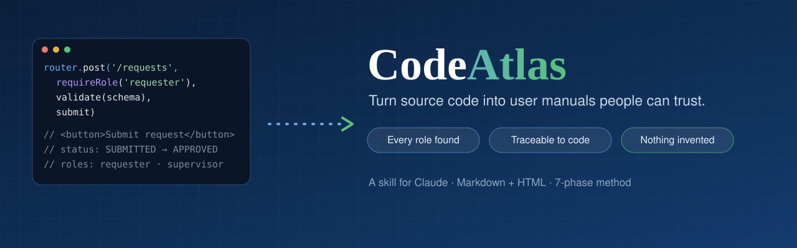
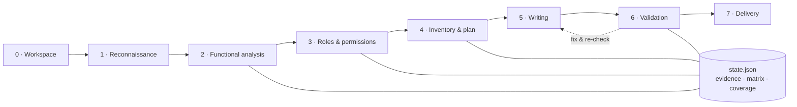
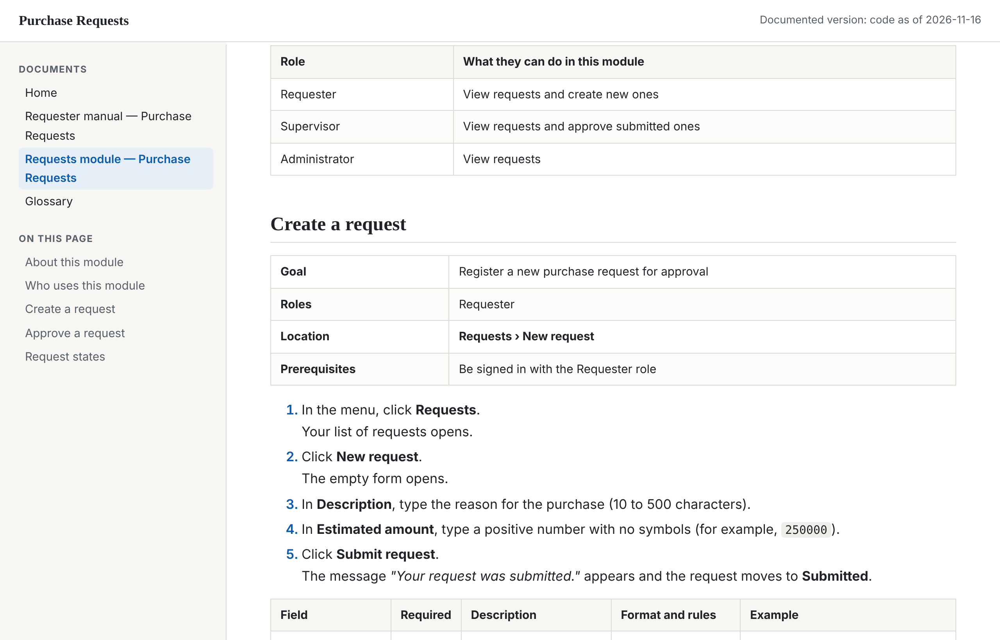
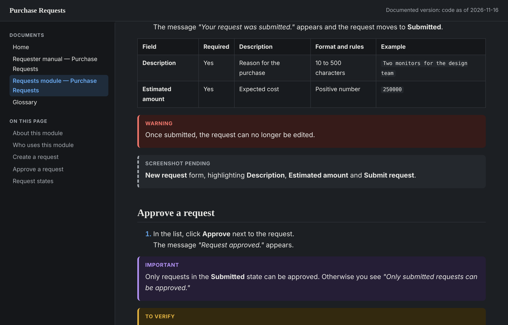

<p align="center">
  
</p>

<p align="center">
  <a href="LICENSE"></a>
  
  
  
  
  
</p>

<p align="center">
  <b>Point Claude at a repository. Get complete, role-by-role user manuals that match what the software really does.</b>
</p>

<p align="center">
  <a href="#-quick-start">Quick start</a> ·
  <a href="#-how-it-works">How it works</a> ·
  <a href="#-what-you-get">What you get</a> ·
  <a href="#-installation">Installation</a> ·
  <a href="#-the-toolbox">Toolbox</a> ·
  <a href="#-faq">FAQ</a>
</p>

---

## ✨ Why CodeAtlas?

User manuals are usually written from memory, from mockups or from what the
product *was supposed to do*. They go stale, skip the error cases and forget
half of the users.

**CodeAtlas is a [Claude skill](https://claude.com/blog/skills)** that writes
manuals the other way around: it reads the source code, follows every feature
from the button to the database, works out who can do what, and only then
writes, citing the code for every claim.

| Without CodeAtlas | With CodeAtlas |
|---|---|
| "Fill in the relevant data and save" | Every field with its label, format, limits and the exact error message |
| One manual for "the user" | A manual per role, including roles nobody wrote down (visitor, record owner, approver, tenant admin…) |
| Only the happy path | Validations, duplicates, forbidden states, cancellations, permission errors |
| Buttons that don't exist | Every label and message checked **verbatim** against the code |
| "Is this still up to date?" | A coverage report that says what's documented, what's pending and what's backend-only |

## 🚀 Quick start

1. [Install the skill](#-installation) in Claude Code or claude.ai.
2. Open your project and ask:

```text
Write the user manual for this app, one per role.
```

Other things you can ask:

```text
Document how a supervisor approves a request.
Create a quick-start guide for our customers.
Continue the manual — you stopped at the billing module.
Genera el manual de usuario en español.
```

Claude runs the 7-phase method, keeps its work in a `manual-docs/` folder and
hands you Markdown sources, a browsable HTML site and a coverage report.

## 🧭 How it works



| Phase | What happens |
|---|---|
| **1 · Reconnaissance** | Detects the stack (20+ frameworks), modules, UI and API routes, role candidates, translations, tests and integrations |
| **2 · Functional analysis** | Follows each action through the whole chain: *screen → call → route → guard → service → database → message on screen* |
| **3 · Roles & permissions** | Finds explicit **and implicit** profiles and checks permissions in **two layers**: what the UI hides and what the server rejects |
| **4 · Inventory** | Builds the feature × role matrix and picks the right set of documents for the app's size |
| **5 · Writing** | Step-by-step procedures from templates: every step says what to do *and what should happen next* |
| **6 · Validation** | Automated checks plus a manual re-read of the code behind every procedure |
| **7 · Delivery** | HTML site, Markdown sources, coverage report and a list of open questions |

### The three rules it never breaks

> **1. Nothing is invented.** If the code doesn't prove it, the manual says
> **To verify** and asks the question instead of guessing.
>
> **2. Evidence before writing.** Every feature is recorded with file and line
> numbers before a single sentence is written.
>
> **3. Written for users, not developers.** Traceability lives in hidden
> markers (`<!-- F-012 -->`), so readers never see class names or endpoints.

## 📦 What you get

<table>
  <tr>
    <td width="50%"></td>
    <td width="50%"></td>
  </tr>
  <tr>
    <td align="center"><sub>Numbered steps with the expected result after each one</sub></td>
    <td align="center"><sub>Field tables and callouts, with automatic dark mode</sub></td>
  </tr>
</table>

```text
manual-docs/
├── manuals/                 ← Markdown sources (edit, version, translate)
│   ├── 00-index.md
│   ├── 01-quick-start.md
│   ├── 02-general-manual.md
│   ├── 10-role-supervisor.md
│   ├── 20-module-requests.md
│   ├── 30-admin-guide.md
│   └── 40-troubleshooting.md
├── html/                    ← self-contained site: sidebar, TOC, dark mode, print-to-PDF
├── screenshots/             ← real screenshots only (never mockups)
├── COVERAGE.md              ← what's documented, per module and per role
└── _work/                   ← state.json, log, analysis notes (for audits & resuming)
```

**Document types:** general manual · per-role manuals · per-module manuals ·
single procedures · administration guide · troubleshooting guide · quick-start
guide.

**Every procedure can include:** goal · roles · location · prerequisites ·
permissions · numbered steps · field table · buttons · validation rules ·
expected result · system messages · states · differences by role ·
restrictions · common problems.

## 🔍 It checks its own work

`validate_manuals.py` catches the mistakes that make manuals untrustworthy.
This is real output from a deliberately flawed draft:

```text
[ERROR]   Marker F-099 does not exist in the inventory
[ERROR]   Link to a missing file: 90-glossary.md
[ERROR]   Empty section: 'States'
[WARNING] F-002: Certainty 'inferred' without a [!TO VERIFY] callout in its section
[WARNING] F-004: Backend-only feature documented in a user manual
[WARNING] Vague phrase: 'fill in the relevant data'
[WARNING] Visible technical term (API route): '/api/requests'
[WARNING] Label not found verbatim in the code: 'Approve request'
```

That last line is the important one: the draft said **Approve request**, but
the real button says **Approve**. CodeAtlas looks up every quoted label and
message in the source code.

And `COVERAGE.md` tells you exactly where you stand:

| Role | Type | Features with access | Written | Validated | Coverage |
|---|---|---|---|---|---|
| R-01 Requester | explicit | 2 | 1 | 1 | 50 % |
| R-02 Supervisor | explicit | 2 | 1 | 0 | 50 % |
| R-03 Administrator | explicit | 1 | 0 | 0 | 0 % |
| R-04 Signed-out visitor | implicit | 0 | 0 | 0 | — |

## 🛠 Installation

The skill lives in the [`codeatlas/`](codeatlas) folder of this repository.

### Claude Code

**For all your projects** (personal skill):

```bash
git clone https://github.com/ladrillopastabase/CodeAtlas.git
mkdir -p ~/.claude/skills
cp -r CodeAtlas/codeatlas ~/.claude/skills/
```

**For one project** (shared with your team through git):

```bash
mkdir -p .claude/skills
cp -r /path/to/CodeAtlas/codeatlas .claude/skills/
git add .claude/skills/codeatlas
```

Claude Code picks up new skills without a restart (if the `skills` folder
didn't exist when the session started, run `/reload-skills`). Use it by
asking naturally, or invoke it directly:

```text
/codeatlas write a manual for each role
```

### claude.ai

1. Build the zip from a clone (the `codeatlas` folder must be at the top of
   the zip): `cd CodeAtlas && zip -r codeatlas.zip codeatlas`
2. Go to **Settings › Capabilities › Skills** and upload the zip.
3. Attach or connect your code and ask for the manual.

### Requirements

- Python **3.8+** for the scripts (standard library only).
- Optional: `pip install markdown` for slightly richer HTML. Without it, a
  built-in converter is used.
- Optional: a running instance of your app, if you want real screenshots.

## 🧰 The toolbox

The method is written for Claude; the repetitive parts are deterministic
scripts you can also run yourself:

| Script | What it does |
|---|---|
| `init_workspace.py PROJECT` | Creates `manual-docs/` with the inventory, the log and folders. Safe to re-run: it resumes |
| `scan_project.py PROJECT` | Detects technologies, routes, HTTP calls, backend routes with no UI caller, role candidates, auth files, translations, jobs, tests and integrations |
| `coverage_report.py manual-docs` | Writes `COVERAGE.md`: per-module and per-role coverage, permission matrix, pending work, findings |
| `validate_manuals.py manual-docs --check-literals` | Inventory integrity, traceability, vague phrases, jargon, broken links, and labels/messages checked against the code |
| `build_html.py manual-docs` | Builds the HTML site: sidebar, TOC, callouts, dark mode, print styles |

```bash
python codeatlas/scripts/scan_project.py ./my-app
python codeatlas/scripts/validate_manuals.py ./my-app/manual-docs --check-literals
```

<details>
<summary><b>Supported stacks</b></summary>

<br>

React / Next.js · Vue / Nuxt · Angular · Svelte · Express · Fastify · Koa ·
NestJS · Django / DRF · Flask · FastAPI · Laravel · Symfony · Spring ·
ASP.NET Core · Ruby on Rails · Go (Gin, Echo, Fiber) · Flutter · React Native ·
Android · iOS, plus server-rendered templates (Blade, Django, Thymeleaf,
Razor, ERB, Jinja).

Monorepos, several apps in one repository and frontend/backend splits are
handled by linking layers through each HTTP call.

</details>

<details>
<summary><b>Roles it looks for (including the ones nobody wrote down)</b></summary>

<br>

Explicit roles from enums, tables, decorators, policies and route guards,
**plus** implicit profiles: anonymous visitor · unverified user · first sign-in
· locked account · record owner · assignee · workflow approver · guest or
external collaborator · tenant member and tenant admin · subscription tier ·
technical superuser · impersonation · API client · external recipient of
action emails · the system itself.

Permissions are checked in two layers. When the UI shows a button that the
server rejects, CodeAtlas documents the real error and records a finding.

</details>

<details>
<summary><b>Big projects</b></summary>

<br>

- Work is saved to `state.json` after every module, so nothing is lost in long
  sessions.
- A `log.md` records the exact next step; "continue the manual" picks up there.
- Modules can be analyzed in parallel by subagents with separate ID ranges.
- Each module has its own Markdown file, so it can be revalidated alone.

</details>

## 🗂 Repository layout

```text
codeatlas/                     ← the skill (copy this folder)
├── SKILL.md                   ← entry point: rules, 7-phase workflow, examples
├── references/                ← method details, loaded only when needed
│   ├── phase-1-reconnaissance.md
│   ├── phase-2-functional-analysis.md
│   ├── phase-3-user-roles.md
│   ├── phase-6-validation.md
│   ├── patterns-by-technology.md
│   ├── state-and-traceability.md
│   ├── documentation-strategy.md
│   ├── writing-guide.md
│   ├── screenshots.md
│   └── testing-the-skill.md
├── assets/
│   ├── templates/             ← 9 templates: general, role, module, procedure, quick start…
│   └── html/                  ← page template and stylesheet
└── scripts/                   ← 5 dependency-free Python tools
docs/images/                   ← images for this README
```

It follows Anthropic's skill-building guide: progressive disclosure (a short
`SKILL.md`, details in `references/`), trigger phrases and negative triggers
in the description, and bundled scripts for the checks that must be
deterministic.

## ❓ FAQ

**Does it need to run my app?**
No. Everything comes from the source code. A running instance is only used
for real screenshots; without one, the manual marks where screenshots should
go.

**What languages can the manuals be in?**
Any. Prose is written in the language you choose; interface labels and
messages are always copied literally from the code or its translation files.
The HTML labels and the validator's vague-phrase checks ship in English and
Spanish.

**Will it document admin-only API endpoints?**
Only if a user can reach them. Backend-only features are listed in the
coverage report, not presented to end users as procedures.

**What happens when the code doesn't say?**
The manual says so in a **To verify** box with a concrete question, and the
question is listed in the delivery summary.

**Does it write developer docs?**
No. API references, READMEs and architecture docs are out of scope on purpose.

## 🤝 Contributing

Issues and pull requests are welcome, especially:

- detection patterns for more frameworks in `scan_project.py`;
- vague-phrase lists for more languages in `validate_manuals.py`;
- trigger test results (see `codeatlas/references/testing-the-skill.md`).

## 📄 License

[MIT](LICENSE)
